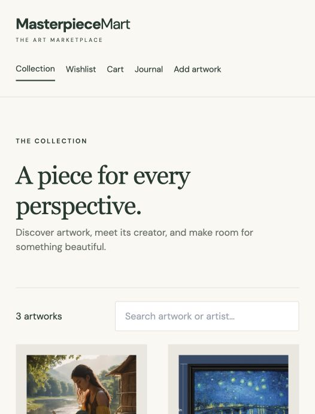

# Masterpiece Mart

An art marketplace for discovering artwork, saving favourites, and sharing the stories behind each piece. Built with **React**, **Java Spring Boot**, and **MySQL**.



## Features

- Browse the artwork collection and search by title or artist.
- Explore artwork details and save favourites to a wishlist.
- Manage a shopping cart and update quantities.
- Upload artwork with images and artist information.
- Publish journal posts, leave comments, and like stories.

## Tech stack

| Layer | Technologies |
| --- | --- |
| Frontend | React, Vite, Tailwind CSS |
| Backend | Java 17, Spring Boot, Spring Data JPA |
| Database | MySQL, H2 for local development |
| Testing & monitoring | Spring Boot Test, JUnit, Actuator |

## Run locally

Requires Java 17, Node.js 20+, npm, and curl.

```bash
git clone https://github.com/satyajit1206/Masterpiece-Mart.git
cd Masterpiece-Mart
bash scripts/start-backend.sh
```

Once the backend starts, open another terminal in the project folder:

```bash
bash scripts/seed-demo.sh
bash scripts/start-frontend.sh
```

Open **http://127.0.0.1:5173**.

The quick start uses an in-memory database. Run the sample-data script once after each backend restart. For persistent storage, see [MySQL configuration](docs/SETUP.md).

## Project structure

```text
masterpiecemart-master/   React frontend
mmBackend-master/        Spring Boot backend
scripts/                 Startup and sample-data scripts
docs/                    Setup guide and screenshots
```

The backend follows a controller → service → repository architecture, with JPA entities for artwork, cart items, wishlists, posts, and comments.

## Tests

```bash
cd mmBackend-master
bash ./mvnw test
```

To build the frontend, run `npm run build` from `masterpiecemart-master`.

## Credits

Developed as a team project. Original team repositories: [frontend](https://github.com/sarthaknayyar/masterpiecemart) · [backend](https://github.com/sarthaknayyar/mmBackend).
